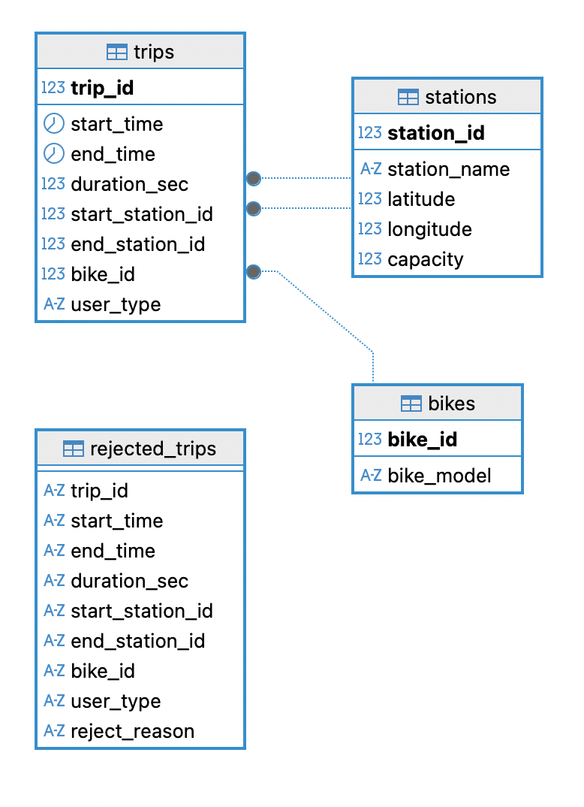

# Bike Share Toronto: Data Model 

A normalized (3NF) PostgreSQL data model for Bike Share Toronto's 2024 ridership data with a Python ETL pipeline and a SQL analysis notebook.

## Schema

  

| Table | Description |
|---|---|
| `trips` | One row per valid trip. Start and end time, duration, start and end station, bike, and user type (`Member` or `Casual`). |
| `stations` | One row per station. Name, latitude, longitude, capacity. |
| `bikes` | One row per bike, with its model (`ICONIC`, `EFIT`, `EFIT G5`). |
| `rejected_trips` | Raw trips that failed validation, stored as text with a `reject_reason`. |
 

## ETL
 
`etl.py` runs three steps:
 
1. **Extract:** reads the ridership CSV and the station JSON.
2. **Transform:** parses timestamps, sets id types, splits valid and rejected trips, and builds the `stations` and `bikes` tables from the trip data, joined with coordinates and capacity from the station feed.
3. **Load:** drops and recreates the tables, then loads them with `COPY`.

## Files
 
| File | Purpose |
|---|---|
| `docker-compose.yml` | PostgreSQL 16 container |
| `ddl_queries.py` | `CREATE` and `DROP` statements |
| `etl.py` | Extract, transform and load |
| `explore_data.ipynb` | Exploration of the raw data |
| `analysis.ipynb` | SQL analysis |
